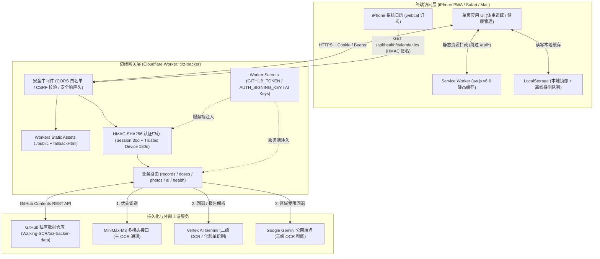
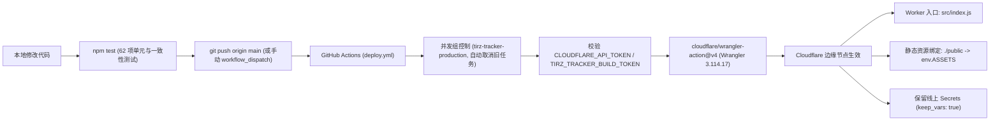
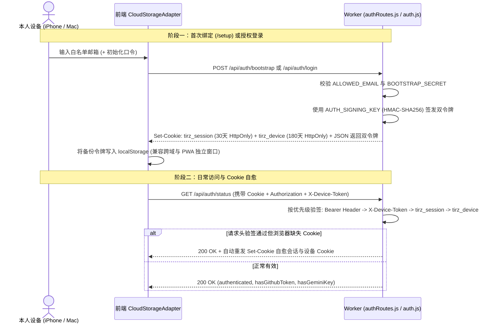
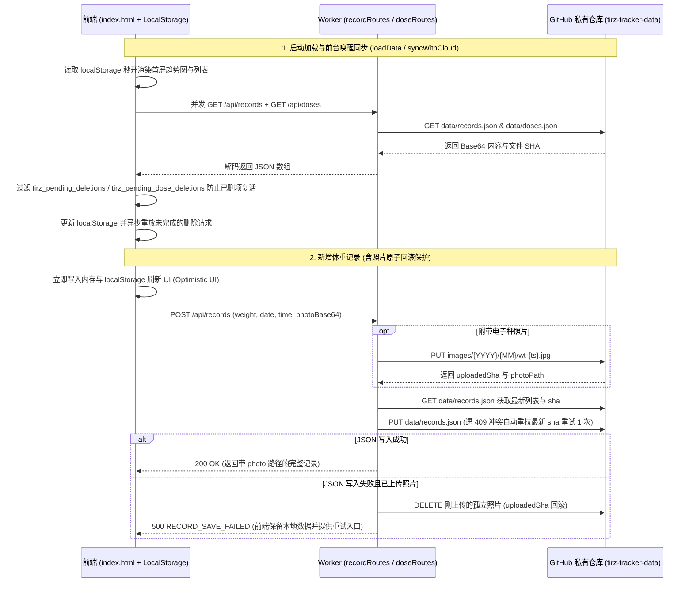
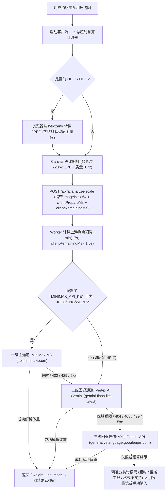
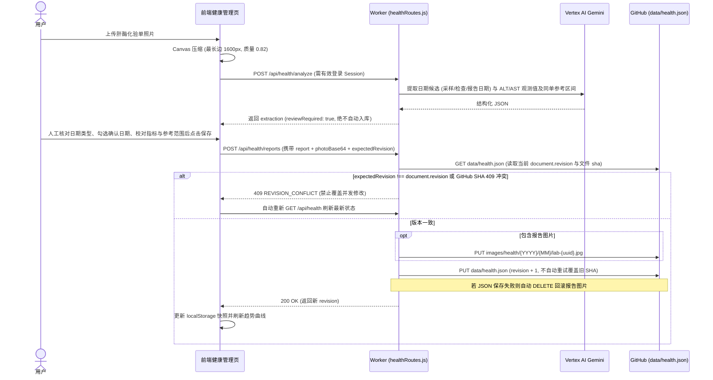

# Tirz Tracker

个人零信任（Zero-Trust）生物指标与健康管理追踪站（PWA），涵盖 **体重与 GLP-1 给药追踪** 及 **私有健康管理（肝酶报告与用药日历订阅）** 两大核心模块。

项目采用 **代码与隐私数据双仓库物理隔离 + Cloudflare Worker 边缘网关代理 + 无外部数据库** 架构：前端与边缘网关代码存放在本仓库，所有个人健康 JSON 与原始图片仅持久化在独立的 GitHub 私有数据仓库中，API 密钥与访问令牌仅保存在 Cloudflare Worker Secrets，浏览器端零明文凭据暴露。

---

## 目录

1. [系统架构总览](#1-系统架构总览)
2. [整体部署链路](#2-整体部署链路)
   - [2.1 CI/CD 自动化发布流水线](#21-cicd-自动化发布流水线)
   - [2.2 三份同源静态产物一致性机制](#22-三份同源静态产物一致性机制)
   - [2.3 多入口访问与边缘静态分发](#23-多入口访问与边缘静态分发)
   - [2.4 本地开发与手动部署配置](#24-本地开发与手动部署配置)
3. [核心数据流向分析](#3-核心数据流向分析)
   - [3.1 全局数据流拓扑](#31-全局数据流拓扑)
   - [3.2 身份认证与受信设备绑定流](#32-身份认证与受信设备绑定流)
   - [3.3 体重与给药记录：乐观本地优先与防复活同步流](#33-体重与给药记录乐观本地优先与防复活同步流)
   - [3.4 电子秤拍照压缩与多级 AI 读数识别流](#34-电子秤拍照压缩与多级-ai-读数识别流)
   - [3.5 私有照片服务端安全代理流](#35-私有照片服务端安全代理流)
   - [3.6 健康管理：化验单识别与乐观锁并发控制流](#36-健康管理化验单识别与乐观锁并发控制流)
   - [3.7 iPhone 私有日历订阅流（Signed ICS）](#37-iphone-私有日历订阅流signed-ics)
4. [存储结构与状态字典](#4-存储结构与状态字典)
5. [Worker API 路由速览](#5-worker-api-路由速览)

---

## 1. 系统架构总览



---

## 2. 整体部署链路

### 2.1 CI/CD 自动化发布流水线

生产环境通过 GitHub Actions（`.github/workflows/deploy.yml`）直连 Cloudflare Workers 完成自动化原子部署：



**关键部署特性：**
- **零构建打包依赖**：前端采用原生 HTML/ES6 + 按需运行时 CDN（Tailwind、Chart.js、Phosphor Icons）与本地 `vendor/heic2any.min.js`；后端为原生 ES Module Worker 代码，无需复杂的 Webpack/Vite 构建步骤即可直接由 Wrangler 打包上传。
- **配置与密钥分离**：非敏感运行参数定义在 `wrangler.jsonc` 的 `vars` 中；敏感密钥保存在 Cloudflare 云端 Secrets，并开启 `"keep_vars": true` 防止 CI 部署冲掉线上已配置的变量。

### 2.2 三份同源静态产物一致性机制

为同时兼顾 **Cloudflare Worker 托管**、**Worker 边缘兜底渲染** 与 **GitHub Pages / 本地静态预览**，仓库内维护了三处同源前端副本，并由 `tests/frontend.test.js` 强制校验字节级一致：

| 文件位置 | 作用说明 | 一致性校验测试 |
| :--- | :--- | :--- |
| 根目录 `index.html`、`sw.js`、`manifest.json` | 主开发源文件，同时支持 GitHub Pages（`walking-scr.github.io`）或本地 `file://` 直接打开 | 基准源文件 |
| `public/index.html`、`public/sw.js`、`public/manifest.json` | `wrangler.jsonc` 中 `assets.directory` 指定的 Cloudflare Workers Static Assets 目录（绑定名 `env.ASSETS`） | 断言与根目录文件完全相等，且 SW 缓存版本同为 `tirz-tracker-v6.6` |
| `src/fallbackHtml.js` | 将 `index.html` 完整编码为 Base64 常量，当 `env.ASSETS` 未命中或 SPA 路由兜底时由 Worker 直接返回 HTML | 断言 `getFallbackHtml()` 解码结果与根 `index.html` 完全相等 |

> 注：`sites/codex-performance/` 为独立的静态性能对比基准站点，从 `public/` 复制界面壳层并注入合成测试数据，不连接生产 API，也不包含任何真实个人数据。

### 2.3 多入口访问与边缘静态分发

1. **Cloudflare Worker 主入口（推荐生产入口）**
   - 浏览器请求直达 Worker（`src/index.js`），前后端同源（前端 `API_BASE = ''`）。
   - `/setup` 路由：服务端预检会话与受信设备状态；若已绑定则 `302` 重定向回 `/`，未绑定则加载 `/index.html?mode=setup` 引导设备初始化。
   - 静态资源加载：优先调用 `env.ASSETS.fetch(request)` 从 Cloudflare 边缘静态资产读取；若未命中且 `Accept` 包含 `text/html`，回退返回 `getFallbackHtml()`。
   - 缓存与安全策略：Worker 对所有 HTML、`sw.js`、`manifest.json` 强制下发 `Cache-Control: no-cache, no-store, must-revalidate` 以及 `X-Content-Type-Options: nosniff`、`X-Frame-Options: DENY`，确保每次打开均获取最新前端逻辑。
2. **GitHub Pages / 本地 `file://` 入口**
   - 前端检测到 `location.protocol === 'file:'` 或域名以 `.github.io` 结尾时，自动将 `API_BASE` 切换至 `https://tirz-tracker.walkingscr.workers.dev`。
   - Worker 的 `isAllowedOrigin` 白名单显式放行同源、`https://walking-scr.github.io` 及 `file://`（`Origin: null`）的跨域凭证请求，并对非白名单来源的状态变更请求（`POST`/`PATCH`/`DELETE /api/*`）执行 CSRF 拦截（返回 `403 CSRF_BLOCKED`）。
3. **PWA Service Worker 客户端缓存策略（`sw.js`）**
   - `/api/*` 路由：**严格绕过缓存**，100% 直通网络，避免任何隐私数据残留于浏览器 Cache Storage。
   - HTML 页面导航：**网络优先（Network-First）**，请求成功后更新缓存，仅在离线断网时回退本地缓存壳层。
   - 第三方 CDN 与应用静态资源：**Stale-While-Revalidate**，优先返回本地缓存加速首屏，后台静默更新。

### 2.4 本地开发与手动部署配置

**环境变量与 Secrets 清单：**

| 变量名 | 配置位置 | 必填 | 用途说明 |
| :--- | :--- | :--- | :--- |
| `GITHUB_OWNER` | `wrangler.jsonc` (`vars`) | 是 | GitHub 用户名（默认 `Walking-SCR`） |
| `GITHUB_DATA_REPO` | `wrangler.jsonc` (`vars`) | 是 | 私有数据仓库名（默认 `tirz-tracker-data`） |
| `GITHUB_BRANCH` | `wrangler.jsonc` (`vars`) | 是 | 数据仓库分支（默认 `main`） |
| `ALLOWED_EMAIL` | `wrangler.jsonc` (`vars`) | 是 | 唯一允许登录与绑定的个人邮箱白名单 |
| `BOOTSTRAP_ENABLED` | `wrangler.jsonc` (`vars`) | 否 | 是否允许 `/api/auth/bootstrap` 新设备绑定（`"false"` 可锁定） |
| `GITHUB_TOKEN` | Worker Secret / `.dev.vars` | 是 | 对私有数据仓库具备 `Contents: Read & Write` 权限的 Fine-Grained PAT |
| `AUTH_SIGNING_KEY` | Worker Secret / `.dev.vars` | 是 | 32 位以上随机密钥，用于会话/设备令牌与日历订阅链接的 HMAC-SHA256 签名（未配置直接拒绝服务，绝不回退默认常量） |
| `BOOTSTRAP_SECRET` | Worker Secret / `.dev.vars` | 建议 | 首次手机设备绑定口令 |
| `MINIMAX_API_KEY` | Worker Secret / `.dev.vars` | 建议 | 电子秤拍照识别主通道（MiniMax-M3）API Key |
| `GEMINI_API_KEY` | Worker Secret / `.dev.vars` | 建议 | 电子秤识别回退通道及健康化验单 OCR（Vertex AI / Gemini）API Key |

**常用命令：**
```bash
# 1. 配置本地开发密钥
cp .dev.vars.example .dev.vars

# 2. 启动本地 Worker 开发服务器
npm run dev

# 3. 运行全量自动化测试
npm test

# 4. 配置线上 Worker Secrets 并手动部署
npx wrangler secret put GITHUB_TOKEN
npx wrangler secret put AUTH_SIGNING_KEY
npx wrangler secret put BOOTSTRAP_SECRET
npx wrangler secret put MINIMAX_API_KEY
npx wrangler secret put GEMINI_API_KEY
npm run deploy
```

---

## 3. 核心数据流向分析

### 3.1 全局数据流拓扑

系统不设传统数据库，全部持久化收敛至私有仓库 `Walking-SCR/tirz-tracker-data` 的 3 份 JSON 文档与 2 类图片目录，但**体重/给药模块**与**健康管理模块**在同步策略和并发模型上做了针对性区分：

- **体重与给药（高频记录场景）**：采用 **乐观本地优先（Optimistic Local-First）+ 离线待删补偿队列**，写操作先落 `localStorage` 秒级响应 UI，再异步同步云端；读取云端时过滤本地待删队列防止旧数据复活。
- **健康管理（严肃医疗检验数据场景）**：采用 **云端权威存储 + `revision` 乐观锁强一致校验**，化验单 OCR 结果必须经人工确认后才入库，`localStorage`（`tirz_health_v1`）仅作断网只读快照，并发冲突直接返回 `409` 拒绝静默覆盖。

---

### 3.2 身份认证与受信设备绑定流



**凭证校验四级链路（`getAuthSession`）：**
1. `Authorization: Bearer <token>` 请求头
2. `X-Device-Token` 请求头
3. `tirz_session`（30 天有效期 `HttpOnly` Cookie）
4. `tirz_device`（180 天有效期受信设备 `HttpOnly` Cookie，确保刷新或会话过期后无需重复输入验证码即可无感续期）

---

### 3.3 体重与给药记录：乐观本地优先与防复活同步流



**关键数据一致性保障：**
- **空数组权威性（`getDoses`）**：`data/doses.json` 为空数组 `[]` 时代表用户已清空全部给药记录，服务端直接返回空数组，不再回退读取旧版 `data/records.json` 中的历史 `doses` 字段，防止最后一条给药记录删除后“死而复生”。
- **级联清理**：`DELETE /api/records/:id` 更新 `data/records.json` 后，会自动查询并删除私有仓库 `images/` 下关联的秤面照片。

---

### 3.4 电子秤拍照压缩与多级 AI 读数识别流

针对移动端弱网与多模态大模型区域可用性限制，拍照识别设计了 **端侧预处理 + 20 秒全链路预算扣除 + 三级上游自动降级**：



---

### 3.5 私有照片服务端安全代理流

GitHub 私有仓库没有公开图片直链，且直接返回 GitHub `download_url` 会在跨域重定向中丢失认证头或暴露仓库结构。所有私有照片均通过 Worker 内存流代理：

1. **路径改写**：前端 `CloudStorageAdapter.resolvePhotoUrl()` 将记录中的相对路径（如 `images/2026/09/wt-xxx.jpg` 或 `images/health/2026/10/lab-xxx.jpg`）转换为 `/api/photos/2026/09/wt-xxx.jpg` 或 `/api/photos/health/2026/10/lab-xxx.jpg`。
2. **服务端解码与格式自适应**：Worker（`src/api/photoRoutes.js`）使用服务端 `GITHUB_TOKEN` 调用 GitHub Contents API 获取 JSON 载荷中的 Base64 字符串；若原扩展名返回 `404`，自动轮询常见图片扩展名（`.jpg`、`.png`、`.webp`、`.jpeg`、`.heic`、`.heif`）。
3. **二进制流响应**：Worker 将 Base64 解码为 `Uint8Array` 二进制流直接返回浏览器，附带 `Cache-Control: private, max-age=86400`（允许当前浏览器私有缓存 24 小时提速，但禁止共享代理与 Service Worker 缓存）。

---

### 3.6 健康管理：化验单识别与乐观锁并发控制流



**趋势绘制安全边界（`src/health.js`）：**
- 仅当报告明确勾选 `dateConfirmed: true` 且具备有效 `examDate` / `reportDate` 时，才会进入按时间轴排序的趋势图（`chronologicalObservations`）。
- 日期未确认的历史导入报告仅按 `sourceOrder` 展示序列预览（`sourceOrderObservations`），不伪造检查日期。

---

### 3.7 iPhone 私有日历订阅流（Signed ICS）

由于 iOS 系统日历后台拉取订阅链接时无法携带浏览器的登录 Cookie，项目采用 **基于版本号的 HMAC-SHA256 不可猜测签名 URL** 实现免 Cookie 的私有订阅与一键吊销：

1. **生成订阅链接（`GET /api/health/calendar-link`，需登录）**：
   - 读取 `data/health.json` 中的 `calendar.version`（初始为 `1`）。
   - 使用 `AUTH_SIGNING_KEY` 对消息 `'tirz-tracker:health-calendar:v1:' + version` 计算 HMAC-SHA256 签名，生成 `webcal://<host>/api/health/calendar.ics?version=<v>&signature=<hex>`。
2. **iOS 日历拉取订阅流（`GET /api/health/calendar.ics`）**：
   - 校验 `signature` 签名合法性（非法直接返回 `404`）。
   - 校验 `health.calendar.active === true` 且 `health.calendar.version === version`；若用户在前端点击“暂停日历同步”，服务端会将 `active` 置为 `false` 并令 `version + 1`，此前泄露或已订阅的旧 URL 立即返回 `410 Subscription revoked`。
   - `buildHealthCalendar()` 根据三类用药计划（口服每日 3 次 `FREQ=DAILY`、晚间外用每日 1 次 `FREQ=DAILY`、涂甲油每 3 天 1 次 `FREQ=DAILY;INTERVAL=3`）实时生成 RFC 5545 标准 `.ics` 日历流：
     - 当日已在前端打卡完成（`done`）或贪睡延后（`snoozed`）的任务时间点会自动写入 `EXDATE` 排除原定提醒；
     - 处于未过期 `snoozedUntil` 状态的任务会额外生成一次性延时提醒事件（含 `VALARM`）。

---

## 4. 存储结构与状态字典

### 4.1 GitHub 私有数据仓库（`Walking-SCR/tirz-tracker-data`）

```text
tirz-tracker-data/
├── data/
│   ├── records.json          # 体重记录文档 { version: "2.0", lastUpdated, weights: [...] }
│   ├── doses.json            # GLP-1 给药记录数组 [ { id, seq, amount, date, time, site, intervalDays, ... } ]
│   └── health.json           # 私有健康文档 { schemaVersion, revision, indicators, reports, medicationPlans, taskCompletions, calendar }
└── images/
    ├── {YYYY}/{MM}/
    │   └── wt-{timestamp}.{jpg|png|webp|heic|heif}       # 电子秤面照片
    └── health/{YYYY}/{MM}/
        └── lab-{uuid}.{jpg|png|webp|heic|heif}           # 医疗检验报告照片
```

### 4.2 浏览器端持久化键名（`localStorage` & `Cookie`）

| 存储位置 | 键名 | 内容与生命周期 |
| :--- | :--- | :--- |
| Cookie (`HttpOnly`) | `tirz_session` | HMAC 签名的会话令牌（有效期 30 天，`Secure; SameSite=Lax`） |
| Cookie (`HttpOnly`) | `tirz_device` | HMAC 签名的受信设备令牌（有效期 180 天，支持无感续期会话） |
| `localStorage` | `tirz_auth_token` / `tirz_device_token` | 令牌前端副本，通过 `Authorization` / `X-Device-Token` 请求头发送以兼容跨域与 PWA 模式 |
| `localStorage` | `tirzepatide_weights_v3` | 体重记录本地缓存镜像 |
| `localStorage` | `tirzepatide_doses_v3` | 给药记录本地缓存镜像 |
| `localStorage` | `tirzepatide_schedule_v1` | 给药周期与默认剂量偏好 |
| `localStorage` | `tirz_pending_deletions` | 离线/失败待重试的体重记录删除 ID 队列 |
| `localStorage` | `tirz_pending_dose_deletions` | 离线/失败待重试的给药记录删除 ID 队列 |
| `localStorage` | `tirz_health_v1` | 健康管理文档本地只读缓存快照 |
| `localStorage` | `tirz_timeline_visible_v1` | 首页疗程时间轴折叠/展开状态偏好 |

---

## 5. Worker API 路由速览

| 路由 | 方法 | 鉴权要求 | 功能与上游流向 |
| :--- | :--- | :--- | :--- |
| `/api/auth/status` | `GET` | 可选（自动验签） | 查询登录与设备绑定状态、服务端密钥就绪状态，缺失 Cookie 时自动补齐 |
| `/api/auth/login` | `POST` | 白名单邮箱校验 | 校验 `ALLOWED_EMAIL`，签发/续期 30 天会话与 180 天设备令牌 |
| `/api/auth/bootstrap` | `POST` | 邮箱 + 初始化口令 | 新设备首次授权绑定（受 `BOOTSTRAP_ENABLED` 与 `BOOTSTRAP_SECRET` 控制） |
| `/api/auth/logout` | `POST` | 无 | 清除 `tirz_session` 会话 Cookie |
| `/api/records` | `GET` | 公开读（需服务端 Token） | 读取 `data/records.json` 体重记录列表 |
| `/api/records` | `POST` | **需 Session** | 上传秤面照片（可选）并新增体重记录，失败自动回滚照片 |
| `/api/records/:id` | `PATCH` / `DELETE` | **需 Session** | 更新记录/替换照片，或删除记录并清理关联私有照片 |
| `/api/doses` | `GET` | 公开读（需服务端 Token） | 读取 `data/doses.json` 给药记录列表 |
| `/api/doses` | `POST` | **需 Session** | 新增 GLP-1 给药记录 |
| `/api/doses/:id` | `PATCH` / `DELETE` | **需 Session** | 更新或幂等删除给药记录 |
| `/api/photos/[health/]:yyyy/:mm/:file` | `GET` | 需服务端 Token | 从私有仓库安全拉取并解码返回照片二进制流 |
| `/api/ai/analyze-scale` | `POST` | 同源/白名单 Origin | 电子秤读数多模态识别（MiniMax-M3 -> Vertex AI -> Gemini 公网端点） |
| `/api/health` | `GET` / `PUT` | **需 Session** | 读取完整健康文档，或更新用药计划与日历启用状态（强校验 `expectedRevision`） |
| `/api/health/analyze` | `POST` | **需 Session** | 调用 Vertex AI Gemini 识别肝酶化验单日期与指标（需人工确认后保存） |
| `/api/health/reports[/:id]` | `POST` / `PATCH` / `DELETE` | **需 Session** | 新增、编辑或确认删除检查报告及私有报告图片（乐观锁保护） |
| `/api/health/indicators[/:id]` | `POST` / `PATCH` / `DELETE` | **需 Session** | 新增自定义指标、切换指标显隐或级联删除该指标观测值 |
| `/api/health/tasks` | `POST` | **需 Session** | 记录当日用药任务完成（`complete`）、撤销（`undo`）或稍后提醒（`snooze`） |
| `/api/health/calendar-link` | `GET` | **需 Session** | 生成带 HMAC 签名的 `webcal://` 与 `https://` 私有日历订阅地址 |
| `/api/health/calendar.ics` | `GET` | **URL HMAC 签名** | 供 iPhone 日历拉取动态生成的 `.ics` 用药提醒订阅流 |
